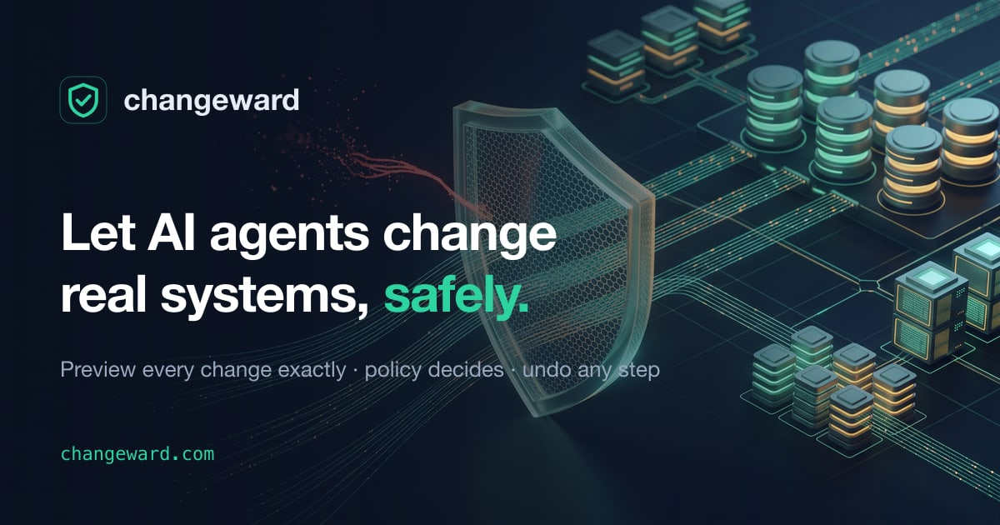
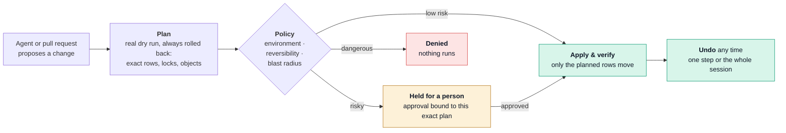

<a href="https://changeward.com"></a>

# Changeward

**Let AI agents change real systems, safely.** Changeward sits between your agents and your databases,
clusters and infrastructure. Every change an agent wants to make is **previewed exactly**, **checked against
your policy**, applied by Changeward, and **kept undoable**. Low-risk changes go through in milliseconds; risky
ones wait for a person; dangerous ones are stopped before they run.

**[Website](https://changeward.com)** · **[Documentation](https://changeward.com/docs)** ·
**[Getting started](https://changeward.com/docs/getting-started)** · Open source, Apache-2.0, pre-release

```console
$ changeward exec "DELETE FROM orders WHERE total > 990"
plan p_5b14 · app (personal) · reversible · 10 rows · live-dry-run
#1 DELETE public.orders — 10 rows
   - id=17 total=999.00 customer_id=4 …
change c_0a34 — verified · 10 rows · DELETE 10

$ changeward undo c_0a34 --yes
undone c_0a34  DELETE FROM orders WHERE total > 990
```

## The problem

Coding agents now run `psql`, `kubectl` and `terraform` with your credentials. In a chat window a dangerous
command looks just like a safe one, because you are shown the **command**, not what it will **do**:

| Looks fine in chat | What it actually does |
| --- | --- |
| `DELETE FROM sessions WHERE user_id = user_id` | A typo that compares a column with itself: it matches every row, so every session is deleted. |
| `ALTER TABLE events ALTER COLUMN id TYPE bigint` | Rewrites the whole table under an exclusive lock. On a big table, writes stop until it finishes. |
| `kubectl apply -f deploy/` | Overwrites the fix someone applied by hand during last night's incident, or fights Argo CD for the object. |
| `terraform apply` | "1 to replace" is an `aws_db_instance`. Replacing a database means destroying it first. |

Today there are two options, and both are bad. **Approve every command:** after the fortieth prompt, people click
"yes" without reading, and reading SQL doesn't tell you how many rows it touches anyway. **Let it run:** you find
out afterwards, and "undo" means restoring a backup.

In July 2025, during an explicit code freeze, an AI coding agent ran destructive commands against a production
database, deleted records for 1,206 executives and 1,196 companies, and then misreported what had happened.
[`demo/replit`](demo/replit) replays that action through Changeward.

## How it works

The agent keeps doing the work. Changeward becomes the only way its changes reach your systems, and it holds the
credentials:



1. **Propose.** The agent calls `propose_change` with the SQL, manifest or plan, plus its intent.
2. **Plan.** Changeward runs it for real but never commits: a rolled-back transaction, a server-side dry run or
   a Terraform plan. It records the exact effects and how to undo them.
3. **Decide.** Policy routes on the environment, how reversible the change is and how much it touches:
   auto-approve, ask you, ask someone else, or deny.
4. **Apply and verify.** Changeward applies exactly the approved plan, then checks that only the planned rows or
   objects moved.
5. **Undo.** Every change keeps a tested undo path. Undo is dependency-aware, and it refuses to overwrite data
   someone changed since.

The same kind of change gets a different decision depending on where it runs (built-in defaults; your own rules
come first):

| The agent wants to… | on | Changeward |
| --- | --- | --- |
| archive 99 inactive customers (`UPDATE`) | `personal` | **auto-approved**, applied in milliseconds, undo ready |
| add an index (`CREATE INDEX CONCURRENTLY`) | `staging` | **auto-approved**: reversible, non-destructive, under 10,000 rows |
| drop a column (`DROP COLUMN`) | `staging` | **held**: destructive, so a second person approves; the agent keeps working |
| delete every session (the typo above) | `prod` | **denied**: production writes need an incident reference and a second approver |

The [website](https://changeward.com) shows this as an animation, with an interactive version you can try.

### Before and after

| Without Changeward | With Changeward |
| --- | --- |
| The agent runs `psql`, `kubectl` or `terraform` directly with your credentials. | The agent calls `propose_change`. Changeward holds the credentials and applies only what was approved. |
| You see what happened afterwards, if you look. | You see the **exact effect first**: rows and before/after values, locks, table rewrites, objects created, changed or destroyed. |
| "Undo" means restoring a backup. | Every change gets a **tested undo path**: row images, soft-dropped tables, previous manifests, the last-applied Terraform config. |
| Approval is all or nothing: the agent asks for every command, or for none. | **Policy routes by risk and environment.** Reversible changes in dev are auto-approved. Production writes need an incident reference and a second person. The agent can never approve its own change. |
| Migrations in PRs are reviewed by reading SQL. | Migrations are **rehearsed on a throwaway copy**: forward, observe, roll back, compare. The PR gets an effect report and a merge gate. |
| The audit trail is scattered shell history. | Every session, plan, decision, approval and undo is in a **hash-chained audit log**, and can be exported to OpenTelemetry. |

### Two lanes, one engine

- **Direct lane:** agents act on live systems through Changeward's MCP server, coding-agent hooks, SDKs or an MCP
  gateway. Each write becomes plan → decision → apply → verify, on a session timeline you can undo step by step.
- **CI lane:** migrations, Kubernetes manifests and Terraform plans in a pull request are rehearsed or dry-run.
  The report is posted on the PR, and policy gates the merge or deploy.

`changeward promote --pr` turns what an agent did directly in dev into migration files and a pull request, so
Git stays the source of truth.

## Supported systems

| System | What you get |
| --- | --- |
| **Postgres** (16 to 18, Neon) | Exact dry runs and row-level undo. Soft-drop for `DROP`/`TRUNCATE`. Checkpoints: template DB, dump or Neon branch. |
| **MySQL** 8 | The same guarantees for data changes; table-level checks for schema changes. |
| **Kubernetes** | Server-side dry-run diffs and exact undo; Argo CD and Flux ownership flagged. |
| **Terraform / OpenTofu** | Only the exact reviewed plan is applied. Destroying stateful resources is irreversible. |
| **NGINX, Traefik, HAProxy** config | Validated before reload, health-checked after, rolled back on failure. |
| **REST APIs** | Undo calls declared per operation in a YAML manifest (e.g. GitHub issues). |

## Quick start (5 minutes)

**1. Install** (pre-release, from source; needs Go 1.27+ and a C compiler):

```sh
git clone https://github.com/srawlin/changeward && cd changeward && make build   # → bin/changeward
export PATH="$PWD/bin:$PATH"
```

Homebrew, `npx @changeward/cli` and `uvx changeward` packages come with the first release
([details](https://changeward.com/docs/getting-started#install)).

**2. Connect a database.** Its environment class decides the default policy:

```sh
changeward connect app --dsn 'postgres://localhost/myapp_dev' --env personal
```

**3. Plug it into your coding agent:**

```sh
changeward install claude-code     # or: codex, opencode, gemini, cursor, agents-md
```

This adds the Changeward MCP server: `query`, `list_tables`, `propose_change`, `apply_change`,
`undo_change`, `get_change_status`, `list_session_changes` and `checkpoint`. It also adds a hook that blocks the
agent's direct writes (`psql`, `kubectl apply`, `terraform apply`, …) and tells it to use those tools.

**4. Ask your agent for a change,** e.g. "archive customers inactive for two years", then look at what happened:

```sh
changeward log                 # the session timeline: every change, its reversibility and state
changeward undo 2 --yes        # undo step 2 (later steps that depend on it are undone first)
changeward rewind --yes        # undo the whole session
changeward ui                  # the same in a local web view
```

The [getting-started guide](https://changeward.com/docs/getting-started) walks through this with a sample
database in Docker.

## Integrations

### Coding agents

| Agent | Setup | What is installed | Guide |
| --- | --- | --- | --- |
| **Claude Code** | `changeward install claude-code` | `.mcp.json` and a PreToolUse hook in `.claude/settings.json` | [Claude Code](https://changeward.com/docs/agents/claude-code) |
| **OpenAI Codex CLI** | `changeward install codex` | `.codex/config.toml`: MCP server and PreToolUse hook | [Codex](https://changeward.com/docs/agents/codex) |
| **OpenCode** | `changeward install opencode` | `opencode.json` and the `.opencode/plugins/changeward.ts` plugin | [OpenCode](https://changeward.com/docs/agents/opencode) |
| **Gemini CLI** | `changeward install gemini` | `.gemini/settings.json`: MCP server and BeforeTool hook | [Gemini CLI](https://changeward.com/docs/agents/gemini-cli) |
| **Cursor** | `changeward install cursor` | `.cursor/mcp.json` and a `beforeShellExecution` hook | [Cursor](https://changeward.com/docs/agents/cursor) |
| **Any MCP client** (Claude Desktop, VS Code, Windsurf, Zed, …) | one JSON snippet | MCP server only | [MCP clients](https://changeward.com/docs/agents/mcp-clients) |
| **Your own agents** (LangGraph, OpenAI Agents SDK, Claude Agent SDK, Vercel AI SDK) | Python / TypeScript SDK | client for a shared executor | [SDKs](https://changeward.com/docs/agents/sdks) |

Claude Code, Codex, OpenCode and Gemini CLI were tested end to end with each real CLI. The agent used
`propose_change` → `apply_change` by itself, and a forced raw `psql DELETE` was blocked by the hook.

### CI/CD and GitOps

| Pipeline | What it does | Guide |
| --- | --- | --- |
| **GitHub Actions** | Rehearses migrations in PRs; posts a report comment and a `changeward/rehearsal` status; report or gate mode | [GitHub Actions](https://changeward.com/docs/ci/github-actions) |
| **GitLab CI/CD** | The same, as a CI/CD component, with MR notes and commit statuses | [GitLab](https://changeward.com/docs/ci/gitlab) |
| **Terraform / OpenTofu** in any CI | `changeward tf review` classifies the plan and gates on policy | [Terraform](https://changeward.com/docs/ci/terraform) |
| **Kubernetes, Argo CD, Flux** | `changeward k8s gate` as a PR check or an Argo CD PreSync hook: a sync waits until its exact plan is approved | [Kubernetes and GitOps](https://changeward.com/docs/ci/kubernetes-gitops) |
| **Any other CI** (Jenkins, CircleCI, Buildkite, …) | The `rehearse`, `gate`, `tf review` and `k8s gate` CLI commands, with exit codes | [Other CI](https://changeward.com/docs/ci/other-ci) |

### Shared executor and gateways

For teams, run `changeward executor serve` next to your systems (Helm chart or systemd). It holds the
credentials, enforces policy and keeps the audit log. Agents, SDKs and gates call it with per-person tokens, so
an agent that gets around a hook still has nothing to make a change with. MCP gateways (**Envoy**,
**agentgateway**, **IBM ContextForge**) can ask it to authorize every tool call. See
[Shared executor](https://changeward.com/docs/executor) and [Gateways](https://changeward.com/docs/gateways).

## Safety model in brief

- **Environment classes** (`personal`, `shared-dev`, `staging`, `prod`, `prod-restricted`) are bound to the
  connection, never chosen by the agent.
- **Reversibility classes:**
  - `reversible`: exact undo.
  - `compensatable`: an inverse call exists.
  - `checkpoint-only`: needs a checkpoint to restore.
  - `irreversible`: the policy sees this.
- **Approvals bind to the plan hash.** If the data or the change moves after approval, it must be planned
  again.
- **Separation of duties:** out-of-band approvals must come from someone other than the proposer. Agents can't
  approve.
- **Dry runs never leak side effects.** Data changes run in a transaction that is always rolled back.
  Statements with effects outside it (`dblink`, `pg_terminate_backend`, `DO` blocks) are never executed while
  planning.
- **Production data stays out of plans.** In production, row values are hidden and keys hashed. CI rehearsals
  use synthetic rows, never sampled from production.
- **Fail closed.** A policy rule that errors counts as "require approval", and gateways deny when Changeward is
  unreachable.

The details are in [Concepts](https://changeward.com/docs/concepts) and [Policy](https://changeward.com/docs/policy).

## Benchmark

[`bench`](bench), the agent unsafe-action benchmark v0: 20 scripted scenarios on Postgres 18, including actions
induced by prompt injection, each run once with raw credentials and once through Changeward.

| | Risky actions that landed with no human decision | Safe actions blocked |
| --- | --- | --- |
| Raw credentials | 14 of 14 (100%) | — |
| Changeward, built-in policy | 2 of 14 (14%) | 0 of 6 |
| Changeward with intent signals | 0 of 14 (0%) | 0 of 6 |

The two misses with built-in policy are small, reversible updates whose effect doesn't match what was asked for;
optional intent signals route both to a person. Median plan latency is about 32 ms, and median undo about 16 ms.
v1 will drive real agents.

## Documentation

The docs are published at **[changeward.com/docs](https://changeward.com/docs)**, with search. Their source is
in [`docs/`](docs).

| | |
| --- | --- |
| [Getting started](https://changeward.com/docs/getting-started) | Install, first target, first agent session, undo |
| [Concepts](https://changeward.com/docs/concepts) | Lanes, plans, environment and reversibility classes, sessions, checkpoints, approvals, audit |
| [Configuration](https://changeward.com/docs/configuration) | `changeward.yaml` and target options for every adapter |
| [Policy](https://changeward.com/docs/policy) | CEL rules, built-in defaults, approvals, Slack, Jev signals |
| [Coding agents](https://changeward.com/docs/agents) | Claude Code, Codex, OpenCode, Gemini CLI, Cursor, other MCP clients, SDKs |
| [CI/CD](https://changeward.com/docs/ci) | GitHub Actions, GitLab, Terraform, Kubernetes/GitOps, other CI |
| [Shared executor](https://changeward.com/docs/executor) and [gateways](https://changeward.com/docs/gateways) | Team deployment, tokens, Helm, Envoy/agentgateway/ContextForge |
| [CLI reference](https://changeward.com/docs/cli) | Every command and flag |
| [Backlog](docs/backlog.md) | Agreed work that is not scheduled yet |

## Development

```sh
make pg     # Postgres 18 (:55418) and 16 (:55416) in Docker for integration tests
make test   # go test ./...
make lint   # golangci-lint
make build  # bin/changeward
```

The code map is in [docs/development.md](docs/development.md). The website's source is in a separate repository,
and its docs pages are synced from `docs/` here. Licensed under Apache-2.0.
